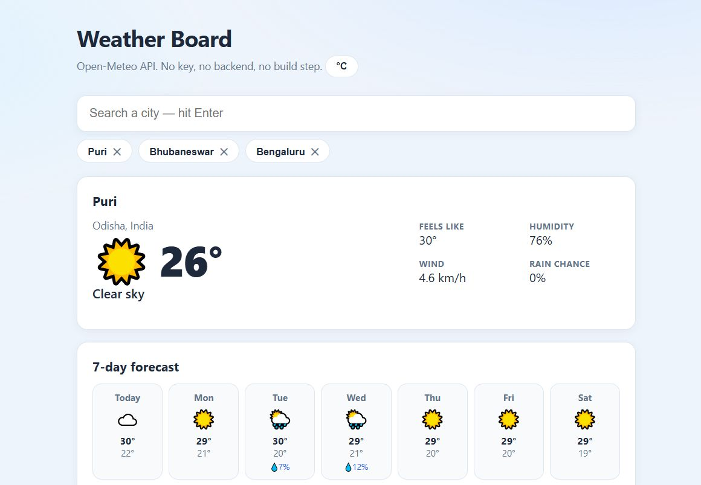

# Weather Board

<p>
  
</p>

A weather dashboard in **pure HTML + CSS + JavaScript**, powered by the [Open-Meteo](https://open-meteo.com) API — free, **no API key**, no backend, no build step. Open the file, search a city, get weather.

## Features

- **Geocoded search** — type a city, get live suggestions (debounced, one request per pause)
- **Current conditions** — temperature, feels-like, humidity, wind, rain chance
- **7-day forecast** — auto-generated icons from WMO weather codes
- **Recent searches** — persisted chips, click to reload, one-tap remove
- **°C / °F toggle** — remembered across sessions
- **Smart reopen** — auto-loads your last searched city on open
- **Honest errors** — no match and network failures both get human messages, never blank screens

## Run it

Open `index.html` (needs internet). Or:

```bash
python -m http.server 8081
# → http://localhost:8081
```

## How it's built (worth reading before the code)

The flow is three steps, in `app.js`:

1. `fetchSuggestions()` → geocoding API turns a name into latitude/longitude
2. `loadWeather()` → forecast API turns coordinates into data
3. `renderWeather()` → data becomes the DOM

Every network call goes through **`fetchJSON()`**, one tiny wrapper that turns every possible failure into a readable sentence — that's the whole error-handling strategy, and it's 10 lines.

`describeCode()` maps Open-Meteo's WMO codes (numbers) to human output (words + emoji):

```js
[0, "Clear sky", "☀️"], [3, "Overcast", "☁️"], [95, "Thunderstorm", "⛈️"] …
```

## The detail worth stealing

The search box **debounces** (350 ms) so typing "Mysore" fires one request instead of six — and suggestions close on Escape/outside click. Fast typers can still race the network; the race is why real apps track "is this response still relevant?" before rendering.

## License

[MIT](LICENSE)
